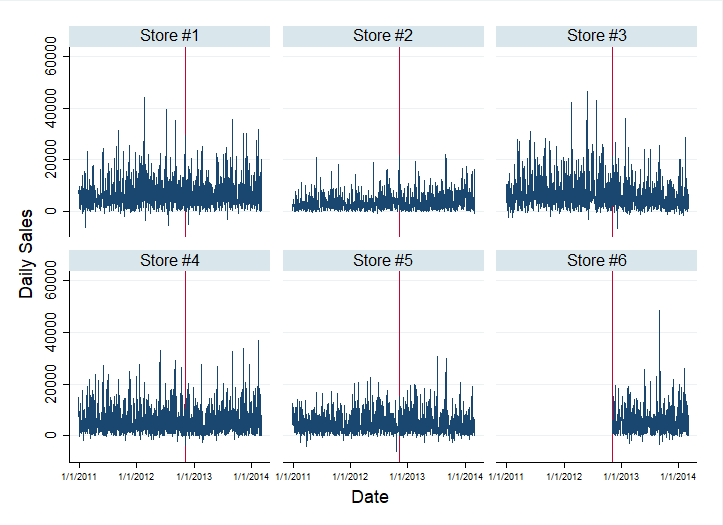
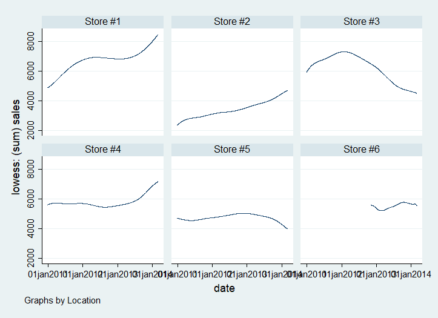
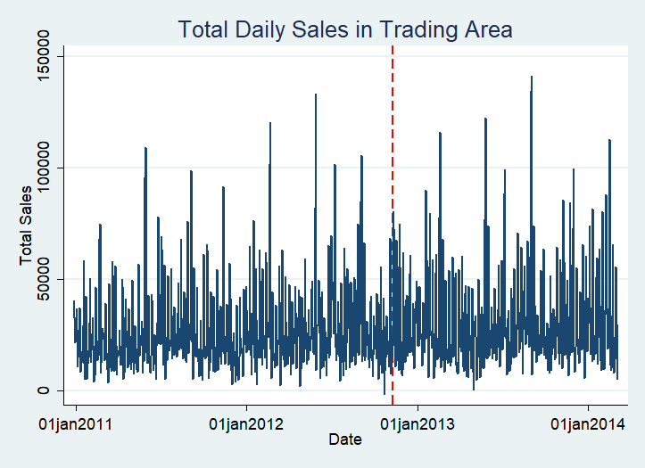

# Store Expansion & Sales Cannibalization Analysis

## Overview

This project analyzes whether the opening of a new retail location was associated with sales cannibalization at existing stores within the same trading area.

Using daily store-level sales data, I examine sales patterns before and after the opening of Store #6 on November 8, 2012. The analysis evaluates both individual store performance and aggregate trading-area sales to distinguish between localized shifts in sales and changes in overall market performance.

The project was completed in **Stata** and includes data preparation, exploratory time-series analysis, smoothing techniques, structural-change regressions, and log-sales specifications.

## Project Files

- [View the Stata analysis](code/01_analysis.do)
- [View regression outputs](output/)
- [View all figures](figures/)
## Research Question

**Did the opening of Store #6 cannibalize sales at existing stores within the same trading area?**

More specifically, the analysis considers whether:

- Existing stores experienced changes in their sales trends following the opening.
- Effects differed across incumbent stores.
- The opening changed the overall sales trajectory of the trading area.

## Methods

The analysis uses daily sales observations for six retail locations, with Store #6 entering the market on November 8, 2012.

The empirical approach includes:

- Aggregation of transaction-level data to daily store sales.
- Time-series visualization of sales before and after the store opening.
- Moving-average and LOWESS smoothing to examine underlying sales patterns.
- Store-level structural-change regressions estimating changes in sales trends after the opening.
- Log-sales specifications to evaluate changes in sales growth.
- Aggregate trading-area analysis to determine whether store-level changes corresponded with changes in total sales.

For each incumbent store, the primary specification takes the form:

`Sales = β₀ + β₁(Time) + β₂(Post) + β₃(Post × Time) + ε`

where the interaction between the post-opening indicator and time captures the estimated change in the store's sales trend following the opening of Store #6.

## Key Findings

The results provide evidence consistent with **localized sales cannibalization**, but the effects were heterogeneous across incumbent stores.

- **Store #3** experienced a statistically significant negative change in its sales trend following the opening of Store #6.
- **Store #5** also showed evidence of a negative change in its sales trend, although the statistical evidence was weaker.
- **Store #4**, in contrast, experienced a statistically significant positive change in its sales trend.
- The remaining incumbent stores did not show strong evidence of a significant deterioration in their sales trends.

These results suggest that the new location did not affect every incumbent store in the same way.

At the **trading-area level**, total sales were already trending upward prior to the opening of Store #6. The estimated change in the aggregate sales trend following the opening was not statistically significant. The log-sales specification similarly did not provide strong evidence that the opening materially changed the trading area's overall sales growth trajectory.

Taken together, the results suggest that Store #6 may have **redistributed sales across locations within the existing store network rather than materially reducing overall trading-area sales**.

## Sales Trends by Store

The figure below shows daily sales across the six store locations, with the vertical line indicating the opening of Store #6.



Because daily sales are volatile, smoothed sales trends provide a clearer view of how store performance evolved around the opening.



## Trading-Area Sales

Aggregating sales across locations provides a different perspective on the expansion. Although individual stores experienced different post-opening trajectories, the aggregate analysis does not show a statistically significant change in the overall trading-area sales trend.



## Interpretation

The distinction between **store-level cannibalization** and **aggregate performance** is important.

A new location can capture sales that otherwise would have occurred at another location owned by the same firm while simultaneously expanding accessibility, capacity, or total sales across the broader trading area. Consequently, declining performance at individual incumbent stores does not necessarily imply that the expansion reduced the firm's aggregate sales within the market.

The results in this analysis are consistent with this distinction: some incumbent stores experienced weaker sales trends following the expansion, but there is not strong statistical evidence of a deterioration in the trading area's overall sales trend.

## Limitations

This analysis primarily uses a before-and-after structural-change framework. Changes occurring after the opening of Store #6 therefore cannot automatically be interpreted as causal effects of the store opening.

Other factors occurring over the same period could also influence sales.

A stronger causal design would incorporate an appropriate comparison group of stores unaffected by a new opening. A treatment-control extension can help distinguish changes associated with the store expansion from broader sales trends occurring during the same period.

## Repository Structure

```text
store-cannibalization-analysis/
├── code/
│   └── 01_analysis.do
├── figures/
│   ├── store_daily_sales.png
│   ├── store_lowess_sales.png
│   ├── trading_area_actual_vs_fitted.png
│   └── trading_area_sales.png
├── output/
│   └── regression results and model output
├── .gitignore
└── README.md
```

## Data Availability

The original dataset was provided for academic coursework and is therefore **not distributed in this public repository**.

The repository contains the Stata analysis code, model outputs, and figures generated from the analysis. The raw data directory is excluded from version control.

## Tools

- **Stata** — data preparation, statistical modeling, and visualization
- **Git/GitHub** — version control and project documentation
